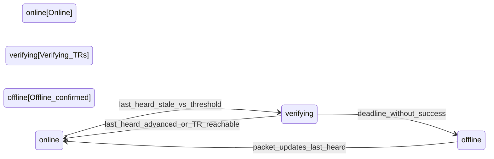

# Mesh monitoring

Mesh monitoring lets users **watch** Meshtastic **observed nodes** on the map. When a watched node has been **silent** longer than a configurable threshold, the system runs a **verification round** (mesh **traceroutes** from nearby infrastructure nodes). If the node still cannot be shown as reachable before a deadline, the system treats it as **offline** and can **notify** watchers (e.g. verified **Discord** DMs).

This document describes the **intended design** (models, Celery, APIs, and integrations). Parts of the stack ship in phases; see **Implementation status** below.

## Implementation status

| Area | Status (typical) |
|------|-------------------|
| Shared helpers (`nodes.managed_node_liveness`, `common.geo`, `nodes.positioning`, `traceroute.trigger_intervals`, random auto TR) | Shipped in API (refactor / traceroute) |
| Verified Discord DMs (prefs, test, `push_notifications.discord`) | Shipped (`users` + `push_notifications`) |
| Django app **`mesh_monitoring`** (`NodeWatch`, `NodePresence`, `NodeMonitoringConfig`), Celery **`process_node_watch_presence`**, `AutoTraceRoute.trigger_type=4` (Node Watch), hooks in **`packets`** + **`traceroute.target_selection`** | **Shipped** (phase 03b) |
| Watch **REST** CRUD | **`GET/POST /api/monitoring/watches/`**, **`GET/PATCH/PUT/DELETE …/watches/{id}/`** — authenticated; see **`openapi.yaml`** (`Mesh Monitoring` tag) |
| Node-level monitoring config (silence + battery) | **`GET/PATCH /api/monitoring/nodes/{internal_id}/config/`** — staff or claim owner may PATCH |
| Alert summary (e.g. Mesh Infra nav) | **`GET /api/monitoring/alerts/summary/?scope=mesh_infra`** — authenticated; optional **`&protocol=meshtastic|meshcore`** (default Meshtastic). Response echoes `protocol` and `supported` (`false` for MeshCore: presence/battery monitoring does not run for MC nodes yet) |
| **UI** (My Nodes watch toggles) | **meshtastic-bot-ui** My Nodes page + `meshtastic-api` client (phase 04) |

Env: **`MESH_MONITORING_VERIFICATION_SECONDS`** (default `180`) for the verification window after silence.

**Ops:** Django Admin **`NodePresence`** lists **`is_offline`**, **`observed_online_at`**, **`suspected_offline_at`**, **`last_tr_sent`**, **`tr_sent_count`**, **`last_zero_sources_at`** so you can see confirmed-offline vs verifying, last “happy” time, verification episodes, TR sends, and “no monitoring sources” events without tailing logs alone. See [flow.md](flow.md) for reset rules.

## Concepts

### What “watched” means

A node is **watched** when there is at least one **`NodeWatch`** row: a user has opted in to monitoring for a specific **`ObservedNode`**, with `enabled=True`.

- **Per-user:** Each watch is `(user, observed_node)` with a **unique** constraint.
- **Eligibility** (who may create a watch): the user **claims** the node (`observed_node.claimed_by == user`) **or** the node’s **role** is in **`nodes.constants.INFRASTRUCTURE_ROLES`** (routers/repeaters/etc., shared with other product rules).
- **Channel opt-ins:** Each watch has **`offline_notifications_enabled`** and **`battery_notifications_enabled`**. Offline monitoring ticks and offline/verification Discord DMs only consider watches with **`enabled=True`** and **`offline_notifications_enabled=True`**. Low-battery Discord DMs require **`battery_notifications_enabled=True`** (and battery alerting must be enabled on **`NodeMonitoringConfig`** for that node).
- **Silence threshold:** **`last_heard_offline_after_seconds`** is stored on **`NodeMonitoringConfig`** (one row per observed node; seconds without **`last_heard`** before verification may start; default **6 hours** / 21600 s). Staff or the **claim owner** may edit it via **`GET/PATCH /api/monitoring/nodes/{internal_id}/config/`**. **`NodeWatch`** / embedded observed node responses still expose read-only **`offline_after`** (seconds) as a convenience alias for the same value.

### Battery alerts (optional)

When **`NodeMonitoringConfig.battery_alert_enabled`** is true, consecutive low **`DeviceMetrics`** readings (below a configurable threshold for N reports) confirm a **battery alert episode** on **`NodePresence`**. Watchers with **`battery_notifications_enabled`** may receive a Discord DM once per episode. Ingestion emits **`device_metrics_recorded`** from **`packets`**; evaluation lives in **`mesh_monitoring`** (receiver + battery evaluator).

### How watching works at runtime

1. **Packet path:** Whenever any packet is processed for a node, **`last_heard`** on **`ObservedNode`** is updated (see `packets` services). That is the primary signal that the node is still seen on the mesh.
2. **Periodic job:** A Celery task (e.g. every minute), **`process_node_watch_presence`**, considers every **`ObservedNode`** that has at least one watch with **`enabled=True`** and **`offline_notifications_enabled=True`**. It compares `last_heard` to the effective threshold from **`NodeMonitoringConfig`** and maintains **`NodePresence`** (one row per observed node used for monitoring state).
3. **Verification:** If the node is “too quiet” but not yet confirmed offline, the system enters a **verifying** state and schedules **monitoring traceroutes** — same **WebSocket** command path as manual/auto TR (`meshtastic-bot`), but `AutoTraceRoute.trigger_type=4` (Node Watch) and `trigger_source` identifies mesh monitoring.
4. **Random auto TR:** The existing **`schedule_traceroutes`** job continues to pick random targets; **`pick_traceroute_target`** **excludes** nodes that are in verification or already **offline_confirmed** so monitoring and random scheduling do not fight over the same targets.

### When a node is treated as offline

**Offline** is **confirmed** only after a **verification window** (on the order of a few minutes): traceroutes are attempted from up to **three** geographically close **managed** sources (with rate limits such as **`MONITORING_TRIGGER_MIN_INTERVAL_SEC`**), and success means either fresh **`last_heard`** after verification started **or** a **completed** monitoring traceroute (including a direct path with empty hop lists; reachability despite sparse packets).

If the deadline passes without success, **`NodePresence.offline_confirmed_at`** is set, **`verification_started_at`** is cleared, and **watchers** are notified (deduped per user). **Discord** delivery uses **`push_notifications.discord.send_dm`** and the same verified-user rules as the test endpoint ([Discord notifications](../discord/notifications.md)).

### How long silence counts as offline

The silence threshold is not always 6 h. A threshold the owner set on **`NodeMonitoringConfig`** wins; otherwise a daily task (**`update_learned_offline_thresholds`**, 03:30 UTC) learns one per watched Meshtastic node from its own cadence (3 x the p90 gap between its packets over the last 7 days, between 6 h and 48 h, **`NodePresence.learned_offline_after_seconds`**); otherwise a 2.8 node gets 12 h and everything else 6 h. This stops a 2.8 node that sends only NodeInfo every few hours being called offline. Offline alerts for such nodes can wait up to 48 h. `last_heard` only moves forward, so a late or badly clocked upload cannot make a node look silent. Details: [Recency](../../RECENCY.md).

### Recovery

Any packet that advances **`last_heard`** should clear **`offline_confirmed_at`** and **`verification_started_at`** on **`NodePresence`** (via a small hook from packet processing into **`mesh_monitoring.services`**). The node is then treated as **online** again for monitoring purposes.

### Replaced numbers

On Meshtastic 2.8 a firmware upgrade or re-key can give a radio a new node number, so a new `ObservedNode` row appears and the old one goes quiet (see the node identity chain). A row is **replaced** when it has a live identity link (`auto` or `confirmed`) to a successor **and** either it has never been heard or the successor was heard at least as recently as it was. For a replaced row, monitoring:

- **pauses offline checks**: no silence detection, no verification traceroutes, no offline DM, and the daily learned-threshold job skips it;
- **leaves its `NodePresence` as it is** (a row already confirmed offline stays that way and resumes when the row stops being replaced);
- **tells each watcher once**: the first presence run that sees the row replaced **and silent past its own offline threshold** (the one presence checks it against) sends each watcher with verified Discord one DM naming the newest identity (kind `node_replaced`). The link records it (`detail.watchers_notified`), so it is never repeated. The wait is deliberate: a forged first packet from a node's predicted number can make a live node look replaced for a moment, and a DM cannot be taken back, so the DM only goes out when an offline alert would have. Until then there is no DM. If the old row was last heard more than 7 days ago, the link is marked `stale` and nothing is sent, so links found long after the fact stay quiet;
- **does not copy watches**: the watcher chooses to watch the new number.

It undoes itself: when the old number is heard again after its successor, or the link is rejected or becomes `suggested`, the row is processed as normal. Implementation: `process_node_watch_presence` in `mesh_monitoring/tasks.py`, rule in `nodes/services/identity_chain.py`.

## Documentation map

| Doc | Contents |
|-----|----------|
| [permissions.md](permissions.md) | Who may **watch** a node vs who may change **`NodeMonitoringConfig`** (staff / claim owner) |
| [models.md](models.md) | **`NodeWatch`**, **`NodeMonitoringConfig`**, **`NodePresence`** fields and how they change at runtime |
| [flow.md](flow.md) | Chronological sequence, state machine, component responsibilities |
| [discord.md](discord.md) | How Discord alerts fit into monitoring (pointer to `docs/features/discord/`) |
| [../discord/README.md](../discord/README.md) | Discord linking + notifications (auth vs DMs) |
| [../traceroute/README.md](../traceroute/README.md) | Traceroute feature, WebSocket delivery, heatmap |

## High-level state (per observed node with ≥1 enabled watch)

For a step-by-step timeline and components, see [flow.md](flow.md).
