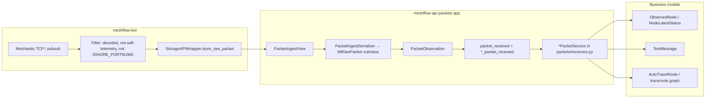

# Meshtastic packet ingestion — data path

Reverse-engineered map of how Meshtastic (MT) traffic moves from a feeder radio through **meshflow-bot** into **meshflow-api** raw tables and downstream business models. Wire field detail lives in [PACKET_FIELDS.md](PACKET_FIELDS.md); dedup rules in [DEDUPLICATION.md](DEDUPLICATION.md).

Upgrading feeders to Meshtastic 2.8: [meshtastic-2.8-upgrade-runbook.md](meshtastic-2.8-upgrade-runbook.md).

Parent epic for MeshCore parity: [meshflow-api#266](https://github.com/pskillen/meshflow-api/issues/266).

---

## Packet types the API accepts

Ingestion is keyed on `decoded.portnum` in the JSON body. It is normalised first (`common/meshtastic_enums.py`): an int or numeric string becomes the `PortNum` name, or `PORT_<n>` when the number is unknown (lib 2.7.11 sends ports it does not know as integers). A port with no typed table is stored as a `GenericPacket`, so a well-formed packet is never a 400 because of its port. Only a missing `decoded` or `decoded.portnum` is a 400.

| `decoded.portnum` | TELEMETRY variant (if applicable) | Raw model (`packets.models`) | Business / side effects |
| --- | --- | --- | --- |
| `TEXT_MESSAGE_APP` | — | `MessagePacket` | `TextMessage` (`original_packet` FK); claim tokens via `text_messages`; `text_message_received` signal |
| `NODEINFO_APP` | — | `NodeInfoPacket` | `ObservedNode` name/role/hw/key fields |
| `POSITION_APP` | — | `PositionPacket` | `Position` row + `NodeLatestStatus` lat/lon/time |
| `TELEMETRY_APP` | `deviceMetrics` | `DeviceMetricsPacket` | `DeviceMetrics` + `NodeLatestStatus` (absent fields stored as null); `device_metrics_recorded` → mesh monitoring |
| `TELEMETRY_APP` | `localStats` | `LocalStatsPacket` | **Raw storage only** — no metrics table; the no-op `GenericPacketService` advances the sender's `last_heard` (stats queries count `LocalStatsPacket` rows) |
| `TELEMETRY_APP` | `environmentMetrics` | `EnvironmentMetricsPacket` | `EnvironmentMetrics` + `NodeLatestStatus` |
| `TELEMETRY_APP` | `airQualityMetrics` | `AirQualityMetricsPacket` | `AirQualityMetrics` + `NodeLatestStatus` |
| `TELEMETRY_APP` | `powerMetrics` | `PowerMetricsPacket` | `PowerMetrics` + `NodeLatestStatus` |
| `TELEMETRY_APP` | `healthMetrics` | `HealthMetricsPacket` | `HealthMetrics` + `NodeLatestStatus` |
| `TELEMETRY_APP` | `hostMetrics` | `HostMetricsPacket` | `HostMetrics` + `NodeLatestStatus` |
| `TELEMETRY_APP` | `trafficManagementStats` | `TrafficManagementStatsPacket` | **Raw storage only** — receiver logs and the no-op `GenericPacketService` advances the sender's `last_heard`; no metrics tables |
| `TRACEROUTE_APP` | — | `TraceroutePacket` | `AutoTraceRoute` completion, Neo4j export, DX/mesh-monitoring via `auto_traceroute_completed_from_packet` |
| Any other port (`STORE_FORWARD_APP`, `ROUTING_APP`, `PORT_<n>`, 2.8's new ports ...) | — | `GenericPacket` | Normal dedup, one `PacketObservation`, sender's `last_heard` via the no-op `GenericPacketService` (`generic_packet_received`). No other side effects |
| `TELEMETRY_APP` | none recognised | `GenericPacket` | As above; `telemetry_variant` is the first dict-valued key of `decoded.telemetry` other than `time` |

Telemetry `time` is optional: protobuf3 drops zero values, so a node with no clock sends no `time` (or `0`/`null`). When `time` is missing, null or `0`, `reading_time` is the packet's `rx_time` (`resolve_reading_time` in `packets/serializers.py`, shared by all eight telemetry serializers). With `time` set, nothing changes.

`GenericPacket` keeps `decoded` (minus `portnum`) as JSON. Ports in `MESHTASTIC_METADATA_ONLY_PORTNUMS` (default `ROUTING_APP`, acks) keep `decoded = null`. A payload over `MESHTASTIC_GENERIC_DECODED_MAX_BYTES` (default 4096) is dropped and `decoded_truncated` is set. A port can later be promoted to a typed table by backfilling from `decoded`. The admin lists `GenericPacket` read-only, filterable by `port_num` and `telemetry_variant`.

`rxTime` is optional. When it is absent, null or `0`, the API uses its own clock for `PacketObservation.rx_time` and sets `PacketObservation.rx_time_estimated = true`; telemetry with no `time` then falls back to that value.

Meshtastic `ObservedNode` lookups by node number go through `nodes/services/observed_nodes.py` (`get_meshtastic_observed_node`, `get_or_create_meshtastic_observed_node`). There is exactly one Meshtastic `ObservedNode` per node number, enforced by the partial unique constraint `nodes_observednode_mt_node_id_unique`; `get_or_create_meshtastic_observed_node` is atomic and a create that loses a race returns the winner's row. The lookup still picks the oldest row (`created_at` nulls last, then `internal_id`) so a database restored from before the constraint degrades gracefully. `python manage.py dedupe_observed_nodes [--dry-run] [--batch-size N]` merges the duplicates into that oldest row (rules in `nodes/services/observed_node_merge.py`: max `last_heard`, best real name, blank identity fields filled, relations re-pointed, a set with two different `claimed_by` owners skipped and reported). It is idempotent, and now mainly a check after a restore (the constraint migration runs the same merge once). A 400 from `PacketIngestView` for an exception names the packet's sender as `"node": "!xxxxxxxx"`.

Every successful ingest also creates **`PacketObservation`** (per feeder hearing) and runs the generic **`packet_received`** receiver (placeholder `ObservedNode`; `meshtastic_inferred_max_hops` updated through `packets/hops.py` for the types whose service does not do it itself, ignoring unknown hops and letting scaled ports only raise it: see [PACKET_FIELDS.md](PACKET_FIELDS.md#hops-decodedbitfield-and-unknown-hop-counts)).

### Not ingested (bot or API)

| Stage | Behaviour |
| --- | --- |
| Bot | `IGNORE_PORTNUMS` env — portnums skipped before POST |
| Bot | No `decoded` / encrypted-only — skipped (no upload) |
| Bot | Self `deviceMetrics` loopback to TCP client — skipped (`is_self_telemetry`) |
| API | Top-level `encrypted` — **304**, no DB write |
| API | Missing `decoded` or `decoded.portnum` (or one over 50 characters) — **400** |

An unknown `portnum` and a `TELEMETRY_APP` packet with no recognised variant are **not** rejected: they are stored as a `GenericPacket` (see above). A missing `rxTime` is not rejected either.

---

## End-to-end flow

---

## Bot → API

| Step | Location | Notes |
| --- | --- | --- |
| Listen | `meshtastic-bot` `MeshtasticRadio` — `meshtastic.receive` | Builds `IncomingPacket` with Meshtastic-shaped `raw` dict |
| Filter | `MeshflowBot._on_packet` | See table above |
| Sanitise | `StorageAPIWrapper.store_raw_packet` | Drops non-JSON `raw` protobuf; base64 `bytes`; fills `channel` |
| POST | `POST /api/packets/{my_nodenum}/ingest/` (or `/api/v3/packets/…`) | Legacy: `my_nodenum` = **observer** (feeder), not sender; `NodeAPIKey` auth on (key, path number) |
| POST (v4) | `POST /api/v4/feeder/meshtastic/ingest/` | Observer = the API key's single feeder; no number in the path, so a 2.8 number change does not break ingest. Needs one key per feeder (403 `shared_api_key` otherwise); bots probe `GET /api/v4/feeder/identity/` first ([ADR-0005](adr/0005-feeder-scoped-auth.md)) |
| Identity headers | `X-Meshtastic-Feeder-Node-Num` (also `-Pubkey`, `-Firmware`) | The reported number is recorded as `ManagedNode.reported_meshtastic_node_id` on v4 and legacy URLs; a mismatch is logged and shown as `identity_mismatch`, never rejected. The firmware version (`X-Meshtastic-Feeder-Firmware`, or `meshtastic_firmware_version` in a bot-version body) is stored as `ManagedNode.reported_firmware_version` / `firmware_reported_at` and feeds the [`feeder_report` firmware rule](inferred-firmware.md). The `bot-version` body also carries `meshtastic_region` and `meshtastic_modem_preset` (sent by the bot on connect); they are stored on `ManagedNode` (`meshtastic_region`, `meshtastic_modem_preset`, `radio_config_reported_at`), normalised to protobuf names (an unknown number becomes `REGION_<n>` / `MODEM_PRESET_<n>`), Meshtastic feeders only. A null preset with a region set means custom modem settings; a body without a region, or with a junk, blank or `UNSET` region (the radio reports none set), leaves all three fields as they were (like firmware, never overwritten and never rejected); a valid region with a missing or junk preset stores a null preset. Names are upper-cased and must match `[A-Z0-9_]+`; negative numbers and non-ASCII digits count as junk. On v4 URLs the pubkey is stored on `ManagedNode.meshtastic_public_key`; see [Feeder number change](#feeder-number-change-auto-re-key) |
| Legacy | `POST /api/raw-packet/` | Still supported by bot for older deployments |
| Failure | `failed_packets_dir` JSON dump | No automatic retry |

Code: `meshflow-bot/src/meshtastic/radio.py`, `src/bot.py`, `src/api/StorageAPI.py`.

---

## API → raw storage

| Step | Location | Notes |
| --- | --- | --- |
| Auth | `NodeAPIKeyAuthentication` + `NodeAuthorizationPermission` | Observer `ManagedNode` on `request.auth.node` |
| Dispatch | `PacketIngestSerializer` | `Meshflow/packets/serializers.py` — portnum → subclass serializer |
| Dedup | `find_existing_packet(from_int, packet_id, rx_time)` | Reuses one `MtRawPacket` per on-air TX within window; always ensures observation |
| Persist | `MtRawPacket` hierarchy + `PacketObservation` | See [README — Storage shape](README.md#storage-shape) |
| Signals | `PacketIngestView` | Type-specific `*_packet_received` + always `packet_received` |

OpenAPI: `openapi.yaml` — `packets` ingest paths.

---

## Raw → business (by app)

### Inside `packets` app (`packets/receivers.py` + `packets/services/`)

All type-specific services extend **`BasePacketService`**: upsert `ObservedNode` (protocol=`MESHTASTIC`), emit `packet_from_node_processed`, update **`last_heard`** (see [RECENCY.md](../../RECENCY.md)), then type logic.

| Service | Primary writes |
| --- | --- |
| `TextMessagePacketService` | `TextMessage` + `original_packet` |
| `NodeInfoPacketService` | `ObservedNode` identity fields, including the normalised key and predicted 2.8 node id (see [Identity evidence](#identity-evidence-and-predicted-28-node-id)) |
| `PositionPacketService` | `Position`, `NodeLatestStatus` |
| `DeviceMetricsPacketService` | `DeviceMetrics`, `NodeLatestStatus`, `device_metrics_recorded` |
| `EnvironmentMetricsPacketService` | `EnvironmentMetrics`, `NodeLatestStatus` |
| `AirQualityMetricsPacketService` | `AirQualityMetrics`, `NodeLatestStatus` |
| `HealthMetricsPacketService` | `HealthMetrics`, `NodeLatestStatus` |
| `HostMetricsPacketService` | `HostMetrics`, `NodeLatestStatus` |
| `PowerMetricsPacketService` | `PowerMetrics`, `NodeLatestStatus` |
| `TraceroutePacketService` | `AutoTraceRoute` + completion signals |

### Other Django apps (subscribe to ingest / post-processing signals)

| App | Trigger | Outcome |
| --- | --- | --- |
| `text_messages` | `message_packet_received` (via packets receiver) | Claims, `text_message_received` |
| `traceroute` | `traceroute_packet_received` → completion wiring | WS notify, Neo4j |
| `mesh_monitoring` | `device_metrics_recorded`, `node_last_heard_advanced`, traceroute completion | Watches / presence |
| `dx_monitoring` | `packet_from_node_processed`, traceroute completion | DX candidates |
| `stats` | ORM on `MtRawPacket` subclasses | Dashboard packet-type counts (not live ingest) |

Post-processing signal catalogue: [signals.md](signals.md).

---

## Provenance FKs (MT)

| Business model | Link to raw |
| --- | --- |
| `TextMessage` | `original_packet` → `MessagePacket` |
| `Position` | No `original_packet` FK today — history keyed by `node` + `reported_time` |
| Metrics tables | Historical rows per ingest; latest mirrored on `NodeLatestStatus` |

Dual-protocol `TextMessage.protocol` and CHECK constraints: `text_messages.models`.

---

## Signing state (2.8)

Each observation records whether its packet was XEdDSA-signed as a tri-state (`xeddsa_signed`: true, false, or null
for unknown), plus the ack-proof status when non-zero. A body with no `xeddsaSigned` key is stored as unknown, never
as unsigned; the bot sends `false` only for a feeder it knows runs 2.8 or later. Unsigned is the normal state, not a
warning. A signature on the body marks the raw packet, and a signed non-replayed packet advances the sender's
`meshtastic_last_signed_at`. Field details: [PACKET_FIELDS.md](PACKET_FIELDS.md#signing-state-28).

## Replayed packets (2.8)

After `config_complete_id`, a 2.8 radio replays its stored per-node records to every client that asks for full
config (the python lib, so the bot): one synthetic POSITION, TELEMETRY (device, environment) and NODE_STATUS packet
per NodeDB node (firmware `PhoneAPI.cpp`, `makeReplay*Packet`). They look like received packets but were not heard on
air. In the dict the bot uploads, a replayed packet has no `rxRssi`, `transportMechanism: TRANSPORT_LORA`,
`priority: BACKGROUND`, a `rxTime` equal to the node's stored `last_heard`, `hopStart` equal to the **feeder's** own
hop limit, and an `id` that is stable across reconnects. Replays lack `rxRssi`, but so do MQTT-downlinked packets and the
feeder's own packets, which is why the rule below also needs LoRa transport, `BACKGROUND` priority and a non-feeder
sender. Live packets never carry a priority.

**Detection** (`packets/replay.py`, `is_replayed_shape`). A packet is a replay when all of these hold:

1. `from` is an int that is not one of the feeder's own node numbers (`ManagedNode.meshtastic_node_id`,
   `reported_meshtastic_node_id`, or the `X-Meshtastic-Feeder-Node-Num` header, which carries the new number after an
   upgrade);
2. `rxRssi` is absent or null;
3. `transportMechanism` is `TRANSPORT_LORA` (or `1`);
4. `priority` is `BACKGROUND` (or `10`);
5. `viaMqtt` is not true and no transport names MQTT.

An MQTT-sourced packet is never a replay, whatever its RSSI. When none of the
feeder's numbers is known, nothing is treated as a replay. The bot applies the same rule (`REPLAYED_PACKETS`); keep
the two in step.

**Body flag.** `replayed: true` in the body marks the observation directly; a bot can only mark its own
observations. The observation is flagged when the body flag **or** the shape says so. An existing observation is
never flipped.

**Kill switch.** `MESHTASTIC_REPLAY_SHAPE_DETECTION` (default `true`; see `docs/ENV_VARS.md`). Off, only the body
flag counts.

**What a replay does.** The typed packet row is stored and `PacketObservation.replayed` is set. It dedupes on
`(from, id)` with no time window ([DEDUPLICATION.md](DEDUPLICATION.md)), so a reconnect adds nothing. The response is
the usual 201.

**What a replay does not do.** `PacketIngestView` sends no signal for it ([signals.md](signals.md)), so:
no `Position`, `DeviceMetrics` or `NodeLatestStatus` change; no `ObservedNode` created and no `last_heard` or
presence change; no inferred max hops; no baseline traceroute; no DX candidate; no battery alert. A replay for a node
the API has never seen creates no node (the bot's NodeDB upload still does). `observation_hop_count` returns null and
`observation_is_direct` false for it, so the observation API shows no hop count and not direct. Stats exclude it
([packet stats](../packet-stats/meshtastic.md)); feeder liveness still counts the upload.

## Non-RF transports

A feeder also receives packets that did not come over its radio. `viaMqtt` and `transportMechanism` are stored on
`PacketObservation` (`via_mqtt`, `transport_mechanism`). An observation is **non-RF** when `via_mqtt` is true or the
transport is `TRANSPORT_MQTT`, `TRANSPORT_MULTICAST_UDP`, `TRANSPORT_UNICAST_UDP` or `TRANSPORT_API`
(`packets.hops.NON_RF_TRANSPORTS`). A null transport is RF: history, and the feeder's own packets (absent
`transportMechanism` is `TRANSPORT_INTERNAL`, not LoRa).

A non-RF observation is treated like a replay by the hop helpers: `observation_hop_count` returns null,
`observation_is_direct` false (so no DX candidate), and `update_inferred_max_hops` ignores it. Neighbour stats read
`rf_observations(...)`, which drops non-RF rows and keeps nulls. Packet-volume stats are unchanged: they count what a
feeder uploaded. RF propagation uses the owner-entered RF profile and reads no observations.

`hopLimit` absent with a non-zero `hopStart` is stored as 0 (last hop used), not unknown; see
[PACKET_FIELDS.md](PACKET_FIELDS.md#transport-and-hop-limit).

## Fixtures and goldens

`docs/packets/meshtastic-2.8/` holds the API's side of the 2.7/2.8 capture subset the bot labels (36 packets from three
feeders, one radio across an upgrade and a re-key): `wire/` has the exact ingest body the bot sends for each packet
(plus a flag-mode body for the seven replays), `golden/` has what the API stores and does with it (packet row,
observation, `ObservedNode`, `NodeLatestStatus` changes, side effects), and `packets/tests/test_meshtastic_goldens.py`
holds the API to them. A change in stored behaviour shows up as a golden diff; see the README there for how to
regenerate and for the label meanings.

## Related docs

- [Packet ingestion hub](README.md)
- [PACKET_FIELDS.md](PACKET_FIELDS.md)
- [Packet stats (MT counts)](../packet-stats/meshtastic.md)
- [Traceroute](../traceroute/)

## Identity evidence and predicted 2.8 node id

In Meshtastic 2.8 a node's number is `crc32` of its 32-byte public key, and an upgrade keeps the key, so each node's post-upgrade number can be predicted from a key we already hold ([ADR-0006](adr/0006-meshtastic-identity-linking.md)).

| Model | Field | Meaning |
| --- | --- | --- |
| `ObservedNode` | `meshtastic_public_key` | Key as received (mixed base64 and hex); unchanged |
| `ObservedNode` | `meshtastic_public_key_hex` | Same key as 64-char lowercase hex; null when absent, malformed or not 32 bytes |
| `ObservedNode` | `meshtastic_key_node_id` | Predicted 2.8 number (`crc32` of the key bytes, indexed); null when there is no usable key |
| `ManagedNode` | `meshtastic_public_key`, `meshtastic_key_node_id` | Same evidence for a feeder, copied from its `ObservedNode` by the backfill |

- Helpers: `common/meshtastic_identity.py` (`normalise_pubkey`, `key_node_id`, `identity_fields`). Bad keys give null, never an error.
- Written by `NodeInfoPacketService` and the node upsert serializer (`BaseNodeSerializer`) whenever a key arrives. Other writers (`ManagedNode` rows) are filled only by the backfill for now.
- `python manage.py backfill_meshtastic_identity [--dry-run] [--batch-size N]` fills existing rows: it reads `ObservedNode.meshtastic_public_key`, falls back to the latest `NodeInfoPacket.public_key` for that `from_int`, copies the key onto a `ManagedNode` with the same number and no key (a stored feeder key is never replaced: the observed row is client-writable; a key it fills in leaves a `key_changed` event, so it is dated like a key recorded from a report and waits out the first-key hour), and reports keys shared by several nodes. It is idempotent and never clears a stored value. **Run it in each environment straight after deploying.**
- Django admin: the observed and managed node lists show the predicted id, can be filtered by whether one exists, and search matches `!<predicted id>` or the start of the hex key.
- **Confirmed on hardware (2026-11-08):** `zlib.crc32` equals the firmware's value (see the runbook). The worked example is the NodeInfo in `docs/packets/nodeinfo_packet.json`: `!da545c78` predicts `!4396524c`. The prediction drives the inferred firmware generation: see [inferred-firmware.md](inferred-firmware.md).

### Feeder number change (auto re-key)

A 2.8 firmware upgrade or re-key changes a feeder's node number. v4 feeder URLs keep ingesting (the API key identifies the feeder); `nodes/services/feeder_identity.py` then keeps `ManagedNode.meshtastic_node_id` in step. The bot sends `X-Meshtastic-Feeder-Node-Num` and `X-Meshtastic-Feeder-Pubkey` (the `bot-version` body fields `meshtastic_node_num` and `meshtastic_public_key` also work). When the reported number is (re)written (on a change, and at most every 10 minutes), a **v4** request runs the decision table below; legacy URLs never re-key. Every row except the last leaves the feeder untouched and writes one `ManagedNodeIdentityEvent` (`outcome=flagged`, with the reason); a repeat with the same number, key and reason writes nothing, and a flagged row is resolved when a later report changes the verdict or the number is back to normal.

| # | Check | Result |
| --- | --- | --- |
| 1 | No public key reported | flagged `key_not_reported` |
| 2 | `crc32(key)` is not the reported number | flagged `crc_mismatch` (on a 2.7 radio the number comes from the MAC, so this usually means a config copied to another radio) |
| 3 | The number is outside the valid node range (below 4, or `0xFFFFFFFF`) | flagged `number_collision` |
| 4 | The key is not already trusted for this feeder: it differs from the stored key, no key is stored, or the stored key was first recorded from a report less than an hour ago | flagged `key_mismatch` (a later report re-evaluates, so a real feeder inside the hour still applies) |
| 5 | Another node holds the key: an `ObservedNode` with that key and a number that is neither the old nor the new one, or another active `ManagedNode` | flagged `shared_key` (keys are not unique; a crc32 match on a cloned key proves nothing) |
| 6 | Another active Meshtastic feeder already has the reported number | flagged `number_collision` |
| 7 | An `ObservedNode` at the reported number has a different key, or is claimed by someone else | flagged `key_mismatch` (key), `number_collision` (claimed) |
| 8 | `MESHTASTIC_FEEDER_AUTO_REKEY` is off, or the newest manual re-point moved the feeder away from the reported number | flagged `auto_rekey_disabled` (a manual reversal holds; it is lifted by a later manual re-point) |
| 9 | Otherwise | applied: number, key and key-node-id updated atomically (`select_for_update`; a unique-constraint race becomes `number_collision`), `auto_updated` event, `ensure_observed_node_for_managed_node` (an unclaimed `ObservedNode` at the new number is claimed for the owner only when the stored key did not come from a feeder report, i.e. has no `key_changed` event; otherwise the normal claim flow applies), then the `nodes.signals.feeder_identity_changed` signal |

crc32 is forgeable, so a match shows only that the report is consistent; see the threat model in [ADR-0005](adr/0005-feeder-scoped-auth.md).

When the number is unchanged: a key that differs from the stored key (or, with none stored, from the feeder's own `ObservedNode` row) is flagged `key_mismatch` and not stored, and stays open until the feeder reports the expected key or staff accept the reported one (`accept_reported_key` on the re-point endpoint, `key_accepted` event). Otherwise open flagged events are resolved, and a first key is stored with a `key_changed` audit event. A downgrade to 2.7 keeps the number and key, so it reports no change. Metric: `meshflow_feeder_identity_changes_total{protocol, outcome}` (`manual` counts owner re-points).

The owner is told by Discord DM on `auto_updated` and on a new `flagged` row, at most one flagged DM per feeder every 24 hours (`nodes/services/feeder_identity_notify.py`; a Celery task queued after commit, never on the request), and can re-point a flagged feeder with `repoint_feeder` (the `repoint-meshtastic-id/` endpoint), which ignores the flag. See [Managed nodes](../node-lifecycle/managed-nodes.md#node-number-changes-28).

### Identity links

When the same radio is seen under two numbers (an upgrade, a re-key or a full erase), the API records one `ObservedNodeIdentityLink` from the old `ObservedNode` row to the new one ([ADR-0006](adr/0006-meshtastic-identity-linking.md)). Rows are never merged and no packet's `from_int` is rewritten, so rolling back is deleting link rows. A signal, `nodes.signals.identity_link_live`, is sent after commit when a link becomes `auto` or `confirmed`.

Links are shown in the API, read-only and in live states only (`auto`, `confirmed`; `suggested`, `rejected` and `flagged` are never shown), through `nodes/services/identity_chain.py`:

- **M2M infra-node list** (`/api/m2m/v1/{meshtastic,meshcore}/infra-nodes`) carries `replaced_by_id` and `previous_id` (direct neighbours, null for an opted-out node), and an M2M opt-out on an old number hides its later numbers; see the M2M API feature doc.
- **Detail** (`GET /nodes/observed-nodes/{id}/`, any lookup form) adds `identity_chain` (`previous` and `next`, each nearest first, capped at 10 steps, stopping at a node already seen) and `replaced_by`.
- **List, mine and search** add `replaced_by` only (the direct successor, no extra queries). `?replaced=false` on the list drops replaced rows.
- **`replaced_by`** is non-null when the node has a live successor and either the node has never been heard or the successor has been heard at least as recently. On detail it names the newest identity in the chain; on lists, the direct successor. An old row heard after its successor keeps `replaced_by` null while its `identity_chain.next` still shows the link. **A predicted-only link does not count:** a link whose evidence is `predicted_number`, while the new row has not stored the key the link rests on, is recorded and listed in `identity_chain` (its `evidence` tells a reader it is unconfirmed) but gives `replaced_by: null` everywhere, so one forged packet carrying a node's predicted number cannot hide a live node or pause its alerts. When that key is heard, the link is superseded by key evidence (it then counts) or demoted (it does not). One definition, `link_counts` / `counting_links_q` in `nodes/services/identity_chain.py`, feeds detail, lists, search, mine, `?replaced=false` and mesh monitoring.

| Evidence | When | State |
| --- | --- | --- |
| `public_key` | A node's number is `crc32` of its key and exactly one other Meshtastic row holds the key (either arrival order) | `auto`, strong |
| `feeder_rekey` | The feeder re-key service moved a managed feeder's number and both rows exist | `auto` (automatic re-key) or `confirmed` (manual re-point), strong; merged into an existing key link |
| `predicted_number` | A new row with no stored key, at its first packet, whose number is the one exactly one other row's stored key predicts (`meshtastic_key_node_id`), when that key is held by that row alone and is not flagged | `auto`, medium. Replaced by `public_key` or `feeder_rekey` evidence when it arrives (the old evidence kept in `detail["earlier"]`); demoted to `suggested` with `detail["key_differs"]` when the new row's key turns out to be a different one; retired to `suggested` (`key_now_shared`) when the old key gains another holder |
| `declared` | A person said the two numbers are one radio (written by the review API; nothing writes it yet) | Set by the writer |
| `mac` | On-air NodeInfo only: exactly one other row is numbered by the MAC's last four bytes or holds the same MAC, and its key differs | `suggested`, medium; never promoted by MAC alone |

- **A key held by several nodes is never linked.** One `flagged` row per key (no old or new node) names every holder in `detail`. If a key that already has an `auto` key link gains a further holder, that link drops to `suggested` (it keeps its row and gets `detail["key_now_shared"]`), so a cloned key is never left linked. A `confirmed` (staff) link, and a `feeder_rekey` link, are left alone. Expect roughly one flagged row per shared key reported by `backfill_meshtastic_identity`.
- **Link at first packet.** `BasePacketService._get_or_create_from_node` calls `detect_at_first_packet` for a row it has just created, before `new_node_observed` is sent. The cost is one indexed lookup on `meshtastic_key_node_id` per new row (plus the holder checks when there is exactly one candidate) and nothing for rows that exist. It never raises: a failure is logged and ingest carries on. The key written later by NodeInfo or a NodeDB upload either confirms the link (same key: the evidence becomes `public_key`, `strong`, still one row and no second `identity_link_live`) or demotes it (different key). A key write now costs one more indexed query, the check for a predicted link whose key differs; a `confirmed` predicted link is a person's decision and is never demoted.
- Detection runs after each of the three key-write sites (on-air NodeInfo, node upsert create and update) and from a `feeder_identity_changed` receiver. It is idempotent and never raises to its caller: a failure is logged and ingest, or a manual re-point, carries on. NodeInfo and NodeDB upserts run it only when the key or the MAC differs from what is stored (or the node is new), so a repeated identical packet costs no identity queries; when a changed key has no other holder the cost is one indexed query, and a changed MAC adds the link check and the candidate lookup. A feeder re-point whose new row does not exist yet records nothing and is not retried; the key evidence from a later NodeInfo still links the pair (as `auto`). NodeDB uploads never count as MAC evidence (2.8 zeroes other nodes' MACs).
- Rules: a state only moves up (suggested, auto, confirmed); a `rejected` row is never recreated or promoted; the reverse of an existing pair is never created; the database allows at most one live (`auto` or `confirmed`) successor per old row and one live predecessor per new row (a refused second link is logged, ingest continues). A 2.8-native node with no other holder, and a downgrade (same row, same key), get nothing.
- Django admin (`Observed node identity links`): list, filter by state, evidence and confidence, search by number (`!8959691b`, hex or decimal) or key; staff confirm or reject by changing the state. Confirming (or otherwise moving a link into `auto`/`confirmed`) sends `identity_link_live`, like the automatic paths. When duplicate rows merge, a `confirmed` link wins over a weaker clashing one.
- `python manage.py detect_meshtastic_identity_links [--dry-run] [--predicted] [--batch-size N]` links what is already stored, from keys only: it reports keyed rows scanned, links created and promoted, flagged rows and the number of unlinkable (shared) keys. `--dry-run` runs the same work in a transaction and rolls it back, so its numbers equal a real run's; a second real run changes nothing. `--predicted` adds a pass over unkeyed rows whose number equals another row's `meshtastic_key_node_id` and links each with the first-packet rule, reporting "Predicted-number links created N, skipped M" (inside the same transaction, so `--dry-run` reports what a real run does). **Run it dry first, then for real, in each environment after deploying; with `--predicted` after the release that adds `predicted_number`.**
- A link made from a managed feeder re-key records the audit event as `detail["feeder_event_id"]`; an existing link for the same pair gains it when it is missing.
- Worked example: PDYt (Heltec Wireless Paper), 2.7 number `!433b82f0` (the last four bytes of its MAC), 2.8 number `!8959691b` (`crc32` of its key). Key evidence links the pair `auto`; with only the MAC known the same pair is `suggested`.
- **A successor is not new.** A row with a live predecessor link (`has_live_predecessor`, any evidence) gets no new-node baseline traceroute and no `new_distant_node` DX event, and a DX exclusion on any earlier number applies to it. Unlike `replaced_by`, a predicted-only link counts here: the only effect is skipping noise, and at a new number's first packet a predicted link is the only link there can be, so a forged first packet costs one skipped baseline and one skipped `new_distant_node` event for the forged row. The check is one `EXISTS` per new row (and per DX-evaluated packet) and writes nothing.
- Indexes: `ObservedNode.meshtastic_public_key_hex` and `ObservedNode.mac_addr` are indexed so the candidate lookups stay cheap.

### Identity data is not clobbered by 2.8 feeder NodeDB entries

2.8 feeders hand the bot NodeDB entries with a zero-filled `macaddr` and a long name cut to 24 bytes (firmware `TypeConversions.cpp`). The node upsert (`BaseNodeSerializer.create/update`) and `NodeInfoPacketService` both pass incoming values through `common.meshtastic_identity.protect_identity`, which drops:

- a blank or all-zero MAC (`00:00:00:00:00:00`, `000000000000`, base64 of six zero bytes): the stored MAC is kept, because MAC evidence is what identity linking uses;
- a blank or null public key: the stored key is kept, and so are the derived `meshtastic_public_key_hex` and `meshtastic_key_node_id` (they are only rewritten when a non-blank key is applied);
- a long name that is exactly the stored name cut to 24 UTF-8 bytes (byte-wise, so a multibyte character split by the cut counts; surrounding whitespace is ignored). A genuine rename still applies.

The node upsert also ignores a position of exactly latitude 0, longitude 0 (NodeDB "no fix"): no `Position` row is written and `NodeLatestStatus` is left alone. The request is still accepted (no 400).

A feeder uploads its radio's whole NodeDB on connect, and that NodeDB is often stale or holds a placeholder (`Meshtastic 5abc` / `5abc`, or the API's own `Unknown Node !xxxxxxxx`). The upload's `last_heard` is the radio's last packet of *any* type, so it cannot date a rename: **on-air NODEINFO is the authority for names**. Only the node upsert passes names through `protect_stale_names` (same module):

- a blank or placeholder name never replaces a real stored one;
- if the node has any stored `NodeInfoPacket`, a different name never replaces a real stored one, whatever `last_heard` says (the node's next NODEINFO broadcast corrects a rename the bot missed). That lookup runs only when the upload carries a name field;
- an upload still fills an empty or placeholder name, and sets names on a node with no `NodeInfoPacket`.

`last_heard` is then clamped by `clamp_last_heard`: the stored value never moves backwards (a node with none takes the incoming value), a value more than 10 minutes in the future is ignored (also on create), and an explicit `null` never clears it. Kept names (with reason `placeholder` or `onair`) and dropped null `last_heard` are logged at INFO, one line per upload. On-air NODEINFO is not filtered.

`NodeInfoPacketService` no longer has a "NodeInfo is for the current node" early return: it compared an int to a str so never fired, and a NodeInfo's `node_id` is always the sender's own id, so a working version would have skipped every update.
