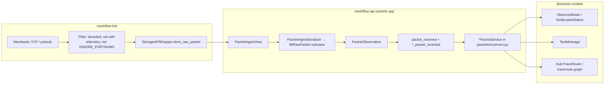

# Meshtastic packet ingestion — data path

Reverse-engineered map of how Meshtastic (MT) traffic moves from a feeder radio through **meshflow-bot** into **meshflow-api** raw tables and downstream business models. Wire field detail lives in [PACKET_FIELDS.md](PACKET_FIELDS.md); dedup rules in [DEDUPLICATION.md](DEDUPLICATION.md).

Upgrading feeders to Meshtastic 2.8 (planned, draft): [meshtastic-2.8-upgrade-runbook.md](meshtastic-2.8-upgrade-runbook.md).

Parent epic for MeshCore parity: [meshflow-api#266](https://github.com/pskillen/meshflow-api/issues/266).

---

## Packet types the API accepts

Ingestion is keyed on `decoded.portnum` in the JSON body. It is normalised first (`common/meshtastic_enums.py`): an int or numeric string becomes the `PortNum` name, or `PORT_<n>` when the number is unknown (lib 2.7.11 sends ports it does not know as integers). A port with no typed table is stored as a `GenericPacket`, so a well-formed packet is never a 400 because of its port. Only a missing `decoded` or `decoded.portnum` is a 400.

| `decoded.portnum` | TELEMETRY variant (if applicable) | Raw model (`packets.models`) | Business / side effects |
| --- | --- | --- | --- |
| `TEXT_MESSAGE_APP` | — | `MessagePacket` | `TextMessage` (`original_packet` FK); claim tokens via `text_messages`; `text_message_received` signal |
| `NODEINFO_APP` | — | `NodeInfoPacket` | `ObservedNode` name/role/hw/key fields |
| `POSITION_APP` | — | `PositionPacket` | `Position` row + `NodeLatestStatus` lat/lon/time |
| `TELEMETRY_APP` | `deviceMetrics` | `DeviceMetricsPacket` | `DeviceMetrics` + `NodeLatestStatus`; `device_metrics_recorded` → mesh monitoring |
| `TELEMETRY_APP` | `localStats` | `LocalStatsPacket` | **Raw storage only** — no metrics table; the no-op `GenericPacketService` advances the sender's `last_heard` (stats queries count `LocalStatsPacket` rows) |
| `TELEMETRY_APP` | `environmentMetrics` | `EnvironmentMetricsPacket` | `EnvironmentMetrics` + `NodeLatestStatus` |
| `TELEMETRY_APP` | `airQualityMetrics` | `AirQualityMetricsPacket` | `AirQualityMetrics` + `NodeLatestStatus` |
| `TELEMETRY_APP` | `powerMetrics` | `PowerMetricsPacket` | `PowerMetrics` + `NodeLatestStatus` |
| `TELEMETRY_APP` | `healthMetrics` | `HealthMetricsPacket` | `HealthMetrics` + `NodeLatestStatus` |
| `TELEMETRY_APP` | `hostMetrics` | `HostMetricsPacket` | `HostMetrics` + `NodeLatestStatus` |
| `TELEMETRY_APP` | `trafficManagementStats` | `TrafficManagementStatsPacket` | **Raw storage only** — receiver logs and the no-op `GenericPacketService` advances the sender's `last_heard`; no metrics tables |
| `TRACEROUTE_APP` | — | `TraceroutePacket` | `AutoTraceRoute` completion, Neo4j export, DX/mesh-monitoring via `auto_traceroute_completed_from_packet` |
| Any other port (`STORE_FORWARD_APP`, `ROUTING_APP`, `PORT_<n>`, 2.8's new ports ...) | — | `GenericPacket` | Normal dedup, one `PacketObservation`, sender's `last_heard` via the no-op `GenericPacketService` (`generic_packet_received`). No other side effects |
| `TELEMETRY_APP` | none recognised | `GenericPacket` | As above; `telemetry_variant` is the first dict-valued key of `decoded.telemetry` other than `time` |

Telemetry `time` is optional: protobuf3 drops zero values, so a node with no clock sends no `time` (or `0`/`null`). When `time` is missing, null or `0`, `reading_time` is the packet's `rx_time` (`resolve_reading_time` in `packets/serializers.py`, shared by all eight telemetry serializers). With `time` set, nothing changes.

`GenericPacket` keeps `decoded` (minus `portnum`) as JSON. Ports in `MESHTASTIC_METADATA_ONLY_PORTNUMS` (default `ROUTING_APP`, acks) keep `decoded = null`. A payload over `MESHTASTIC_GENERIC_DECODED_MAX_BYTES` (default 4096) is dropped and `decoded_truncated` is set. A port can later be promoted to a typed table by backfilling from `decoded`. The admin lists `GenericPacket` read-only, filterable by `port_num` and `telemetry_variant`.

`rxTime` is optional. When it is absent, null or `0`, the API uses its own clock for `PacketObservation.rx_time` and sets `PacketObservation.rx_time_estimated = true`; telemetry with no `time` then falls back to that value.

Meshtastic `ObservedNode` lookups by node number go through `nodes/services/observed_nodes.py` (`get_meshtastic_observed_node`, `get_or_create_meshtastic_observed_node`). There is no unique constraint on the number yet, so duplicate rows can exist; the helpers pick the oldest (`created_at` nulls last, then `internal_id`) and log one WARNING naming `!xxxxxxxx`. `python manage.py dedupe_observed_nodes [--dry-run] [--batch-size N]` merges the duplicates into that oldest row (rules in `nodes/services/observed_node_merge.py`: max `last_heard`, best real name, blank identity fields filled, relations re-pointed, a set with two different `claimed_by` owners skipped and reported). It is idempotent. **Back up, run `--dry-run`, then run it for real; pre-prod first.** A 400 from `PacketIngestView` for an exception names the packet's sender as `"node": "!xxxxxxxx"`.

Every successful ingest also creates **`PacketObservation`** (per feeder hearing) and runs the generic **`packet_received`** receiver (placeholder `ObservedNode`, `meshtastic_inferred_max_hops` when `hop_start` is present).

### Not ingested (bot or API)

| Stage | Behaviour |
| --- | --- |
| Bot | `IGNORE_PORTNUMS` env — portnums skipped before POST |
| Bot | No `decoded` / encrypted-only — skipped (no upload) |
| Bot | Self `deviceMetrics` loopback to TCP client — skipped (`is_self_telemetry`) |
| API | Top-level `encrypted` — **304**, no DB write |
| API | Missing `decoded` or `decoded.portnum` (or one over 50 characters) — **400** |

An unknown `portnum` and a `TELEMETRY_APP` packet with no recognised variant are **not** rejected: they are stored as a `GenericPacket` (see above). A missing `rxTime` is not rejected either.

---

## End-to-end flow

---

## Bot → API

| Step | Location | Notes |
| --- | --- | --- |
| Listen | `meshtastic-bot` `MeshtasticRadio` — `meshtastic.receive` | Builds `IncomingPacket` with Meshtastic-shaped `raw` dict |
| Filter | `MeshflowBot._on_packet` | See table above |
| Sanitise | `StorageAPIWrapper.store_raw_packet` | Drops non-JSON `raw` protobuf; base64 `bytes`; fills `channel` |
| POST | `POST /api/packets/{my_nodenum}/ingest/` | `my_nodenum` = **observer** (feeder), not sender; `NodeAPIKey` auth |
| Legacy | `POST /api/raw-packet/` | Still supported by bot for older deployments |
| Failure | `failed_packets_dir` JSON dump | No automatic retry |

Code: `meshflow-bot/src/meshtastic/radio.py`, `src/bot.py`, `src/api/StorageAPI.py`.

---

## API → raw storage

| Step | Location | Notes |
| --- | --- | --- |
| Auth | `NodeAPIKeyAuthentication` + `NodeAuthorizationPermission` | Observer `ManagedNode` on `request.auth.node` |
| Dispatch | `PacketIngestSerializer` | `Meshflow/packets/serializers.py` — portnum → subclass serializer |
| Dedup | `find_existing_packet(from_int, packet_id, rx_time)` | Reuses one `MtRawPacket` per on-air TX within window; always ensures observation |
| Persist | `MtRawPacket` hierarchy + `PacketObservation` | See [README — Storage shape](README.md#storage-shape) |
| Signals | `PacketIngestView` | Type-specific `*_packet_received` + always `packet_received` |

OpenAPI: `openapi.yaml` — `packets` ingest paths.

---

## Raw → business (by app)

### Inside `packets` app (`packets/receivers.py` + `packets/services/`)

All type-specific services extend **`BasePacketService`**: upsert `ObservedNode` (protocol=`MESHTASTIC`), emit `packet_from_node_processed`, update **`last_heard`** (see [RECENCY.md](../../RECENCY.md)), then type logic.

| Service | Primary writes |
| --- | --- |
| `TextMessagePacketService` | `TextMessage` + `original_packet` |
| `NodeInfoPacketService` | `ObservedNode` identity fields, including the normalised key and predicted 2.8 node id (see [Identity evidence](#identity-evidence-and-predicted-28-node-id)) |
| `PositionPacketService` | `Position`, `NodeLatestStatus` |
| `DeviceMetricsPacketService` | `DeviceMetrics`, `NodeLatestStatus`, `device_metrics_recorded` |
| `EnvironmentMetricsPacketService` | `EnvironmentMetrics`, `NodeLatestStatus` |
| `AirQualityMetricsPacketService` | `AirQualityMetrics`, `NodeLatestStatus` |
| `HealthMetricsPacketService` | `HealthMetrics`, `NodeLatestStatus` |
| `HostMetricsPacketService` | `HostMetrics`, `NodeLatestStatus` |
| `PowerMetricsPacketService` | `PowerMetrics`, `NodeLatestStatus` |
| `TraceroutePacketService` | `AutoTraceRoute` + completion signals |

### Other Django apps (subscribe to ingest / post-processing signals)

| App | Trigger | Outcome |
| --- | --- | --- |
| `text_messages` | `message_packet_received` (via packets receiver) | Claims, `text_message_received` |
| `traceroute` | `traceroute_packet_received` → completion wiring | WS notify, Neo4j |
| `mesh_monitoring` | `device_metrics_recorded`, `node_last_heard_advanced`, traceroute completion | Watches / presence |
| `dx_monitoring` | `packet_from_node_processed`, traceroute completion | DX candidates |
| `stats` | ORM on `MtRawPacket` subclasses | Dashboard packet-type counts (not live ingest) |

Post-processing signal catalogue: [signals.md](signals.md).

---

## Provenance FKs (MT)

| Business model | Link to raw |
| --- | --- |
| `TextMessage` | `original_packet` → `MessagePacket` |
| `Position` | No `original_packet` FK today — history keyed by `node` + `reported_time` |
| Metrics tables | Historical rows per ingest; latest mirrored on `NodeLatestStatus` |

Dual-protocol `TextMessage.protocol` and CHECK constraints: `text_messages.models`.

---

## Related docs

- [Packet ingestion hub](README.md)
- [PACKET_FIELDS.md](PACKET_FIELDS.md)
- [Packet stats (MT counts)](../packet-stats/meshtastic.md)
- [Traceroute](../traceroute/)

## Identity evidence and predicted 2.8 node id

In Meshtastic 2.8 a node's number is `crc32` of its 32-byte public key, and an upgrade keeps the key, so each node's post-upgrade number can be predicted from a key we already hold ([ADR-0006](adr/0006-meshtastic-identity-linking.md)).

| Model | Field | Meaning |
| --- | --- | --- |
| `ObservedNode` | `meshtastic_public_key` | Key as received (mixed base64 and hex); unchanged |
| `ObservedNode` | `meshtastic_public_key_hex` | Same key as 64-char lowercase hex; null when absent, malformed or not 32 bytes |
| `ObservedNode` | `meshtastic_key_node_id` | Predicted 2.8 number (`crc32` of the key bytes, indexed); null when there is no usable key |
| `ManagedNode` | `meshtastic_public_key`, `meshtastic_key_node_id` | Same evidence for a feeder, copied from its `ObservedNode` by the backfill |

- Helpers: `common/meshtastic_identity.py` (`normalise_pubkey`, `key_node_id`, `identity_fields`). Bad keys give null, never an error.
- Written by `NodeInfoPacketService` and the node upsert serializer (`BaseNodeSerializer`) whenever a key arrives. Other writers (`ManagedNode` rows) are filled only by the backfill for now.
- `python manage.py backfill_meshtastic_identity [--dry-run] [--batch-size N]` fills existing rows: it reads `ObservedNode.meshtastic_public_key`, falls back to the latest `NodeInfoPacket.public_key` for that `from_int`, copies the key onto the `ManagedNode` with the same number, and reports keys shared by several nodes. It is idempotent and never clears a stored value. **Run it in each environment straight after deploying.**
- Django admin: the observed and managed node lists show the predicted id, can be filtered by whether one exists, and search matches `!<predicted id>` or the start of the hex key.
- **Unverified:** that `zlib.crc32` equals the firmware's value is inferred from source. The worked example is the NodeInfo in `docs/packets/nodeinfo_packet.json`: `!da545c78` predicts `!4396524c`. Nothing acts on a prediction yet; hardware verification is tracked in api#439 and the runbook.

### Identity data is not clobbered by 2.8 feeder NodeDB entries

2.8 feeders hand the bot NodeDB entries with a zero-filled `macaddr` and a long name cut to 24 bytes (firmware `TypeConversions.cpp`). The node upsert (`BaseNodeSerializer.create/update`) and `NodeInfoPacketService` both pass incoming values through `common.meshtastic_identity.protect_identity`, which drops:

- a blank or all-zero MAC (`00:00:00:00:00:00`, `000000000000`, base64 of six zero bytes): the stored MAC is kept, because MAC evidence is what identity linking uses;
- a blank or null public key: the stored key is kept, and so are the derived `meshtastic_public_key_hex` and `meshtastic_key_node_id` (they are only rewritten when a non-blank key is applied);
- a long name that is exactly the stored name cut to 24 UTF-8 bytes (byte-wise, so a multibyte character split by the cut counts; surrounding whitespace is ignored). A genuine rename still applies.

The node upsert also ignores a position of exactly latitude 0, longitude 0 (NodeDB "no fix"): no `Position` row is written and `NodeLatestStatus` is left alone. The request is still accepted (no 400).

A feeder uploads its radio's whole NodeDB on connect, and that NodeDB is often stale or holds a placeholder (`Meshtastic 5abc` / `5abc`, or the API's own `Unknown Node !xxxxxxxx`). The upload's `last_heard` is the radio's last packet of *any* type, so it cannot date a rename: **on-air NODEINFO is the authority for names**. Only the node upsert passes names through `protect_stale_names` (same module):

- a blank or placeholder name never replaces a real stored one;
- if the node has any stored `NodeInfoPacket`, a different name never replaces a real stored one, whatever `last_heard` says (the node's next NODEINFO broadcast corrects a rename the bot missed). That lookup runs only when the upload carries a name field;
- an upload still fills an empty or placeholder name, and sets names on a node with no `NodeInfoPacket`.

`last_heard` is then clamped by `clamp_last_heard`: the stored value never moves backwards (a node with none takes the incoming value), a value more than 10 minutes in the future is ignored (also on create), and an explicit `null` never clears it. Kept names (with reason `placeholder` or `onair`) and dropped null `last_heard` are logged at INFO, one line per upload. On-air NODEINFO is not filtered.

`NodeInfoPacketService` no longer has a "NodeInfo is for the current node" early return: it compared an int to a str so never fired, and a NodeInfo's `node_id` is always the sender's own id, so a working version would have skipped every update.
