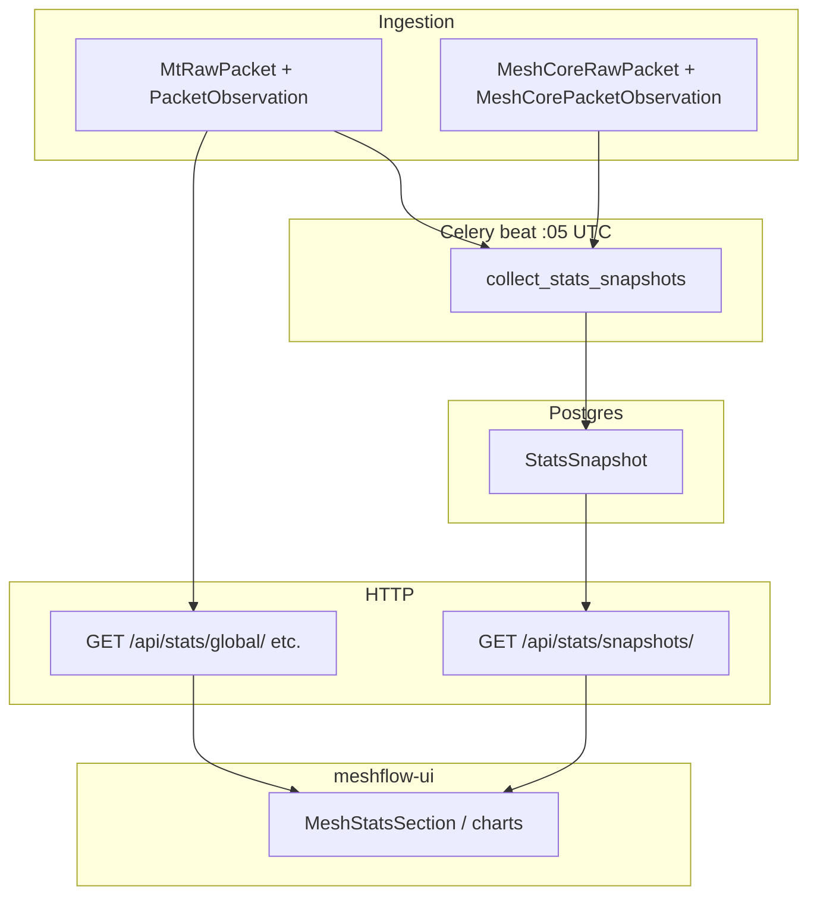

# Packet statistics

**Status:** Done · **Tracking:** https://github.com/pskillen/meshflow-ui/issues/407

## Problem

Operators and the dashboard need **packet and node activity statistics** over short and long ranges. Two mechanisms coexist:

1. **Stored hourly snapshots** — Celery writes completed-hour aggregates into `StatsSnapshot` (cheap to chart over long ranges). They cover Meshtastic and MeshCore (`mc_*` types).
2. **Live aggregation** — HTTP handlers query `MtRawPacket` / `PacketObservation` on demand for arbitrary date ranges and intervals. These endpoints are **Meshtastic only**.

Django app: [`Meshflow/stats/`](../../../Meshflow/stats/). Related but separate: traceroute daily and hourly success stats in `traceroute_analytics` — see [traceroute](../traceroute/README.md).

## Time and day boundaries

All stats are **UTC** (`TIME_ZONE = "UTC"`):

- Hourly snapshots cover UTC hours, and `recorded_at` is the **start** of the completed hour.
- Live endpoints `Trunc` in UTC.
- `recent_counts` uses rolling windows (2h, 24h, …) rather than calendar days.

Wherever an API reports a calendar day ("today", daily buckets), the day is the **UTC day**: 00:00–24:00 UTC. During
British Summer Time, the UK day starts at 23:00 UTC the previous evening. Consumers should use the timestamps in the
response rather than assuming local time. See also the [M2M API](../m2m-api/README.md#time-and-day-boundaries).

## Documentation map

| Doc | Contents |
| --- | --- |
| [meshtastic.md](meshtastic.md) | Meshtastic snapshots, collectors, live API, UI consumers |
| [meshcore.md](meshcore.md) | MeshCore snapshot types (`mc_*`) |
| [../node-metrics/README.md](../node-metrics/README.md) | Node telemetry history and `bucket` rules |
| [../traceroute/README.md](../traceroute/README.md) | Hourly traceroute success trend |
| [../../RECENCY.md](../../RECENCY.md) § `stats/` | Ops quick reference (windows, beat schedule) |
| [../packet-ingestion/README.md](../packet-ingestion/README.md) | Where `MtRawPacket` / `MeshCoreRawPacket` originate |

## Concepts

- **Online** is the number of distinct senders heard over any transport (RF or MQTT) in the closed window `[H-1h, H+1h]` around the point, counted from raw packets without replays, not from `last_heard`. A MeshCore sender is keyed on its 12-hex pubkey prefix. See [meshtastic.md](meshtastic.md#online_nodes).
- **One `bucket` vocabulary:** `1h`, `6h`, `1d`. Gauges are averaged (half up) and flows are summed. Daily snapshot rollups are computed per request, not stored, and `value.samples` marks partial days. See [meshtastic.md](meshtastic.md#stored-snapshots).

## High-level flow

## Decisions

All decided in https://github.com/pskillen/meshflow-ui/issues/407.

- Online is counted from packets, so nodes heard again after the hour stay counted. The backfill rewrites existing rows only, so the accepted snapshot gap stays.
- Any transport counts. Window edges are inclusive. `--rewrite-online` never inserts and skips rows whose window the raw packets don't fully cover.
- The point at hour H counts `[H-1h, H+1h]`, so it includes the hour just finished and lines up with packet volume.
- Rollups: gauges mean, flows sum, one `bucket` vocabulary, battery 101 left out of means.
- The daily rollup is computed per request, not stored. Rolled rows have `id: null` and `value.samples`. An unknown `stat_type` with `bucket` is a 400. `recorded_at_after` is required with `bucket`.
- Indexes on `MtRawPacket.first_reported_time` and `PacketObservation.rx_time` (migration `packets/0024`).

## Known gaps

- Device metrics stored before null ingestion use 0 for a missing reading: https://github.com/pskillen/meshflow-api/issues/524
- Packet stats `interval` other than 1 does nothing; `openapi.yaml` fails strict YAML parsers; node metric dates parse naive; `meshcore.md` still reads as a plan: https://github.com/pskillen/meshflow-api/issues/525
- Live endpoints don't accept MeshCore identities.
- `packet_volume` has no per-constellation snapshots.

## Operations

Backfill with `backfill_stats_snapshots [--days N]`; run `--rewrite-online --dry-run --days 1` first. See [meshtastic.md](meshtastic.md#celery-snapshot-collection).

## Cross-links

- **Permissions:** snapshots and global live stats are guest-readable; per-node live stats require authenticated user ([permissions](../../permissions/README.md)).
- **OpenAPI:** `Stats` tag — [`openapi.yaml`](../../../openapi.yaml).
- **MeshCore:** [phase-2-outstanding.md](../meshcore/phase-2-outstanding.md).
